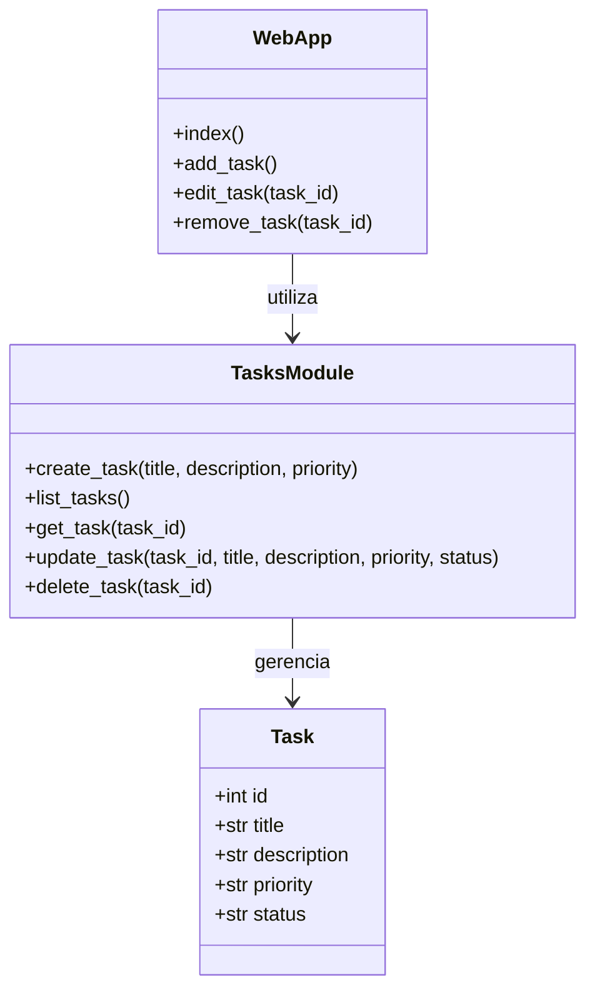

# Diagrama UML — Classes

**Observação:** o diagrama apresenta os conceitos e as responsabilidades do sistema. `TasksModule` representa o módulo `tasks.py`, que contém as funções de gerenciamento das tarefas. `WebApp` representa conceitualmente a aplicação web.
