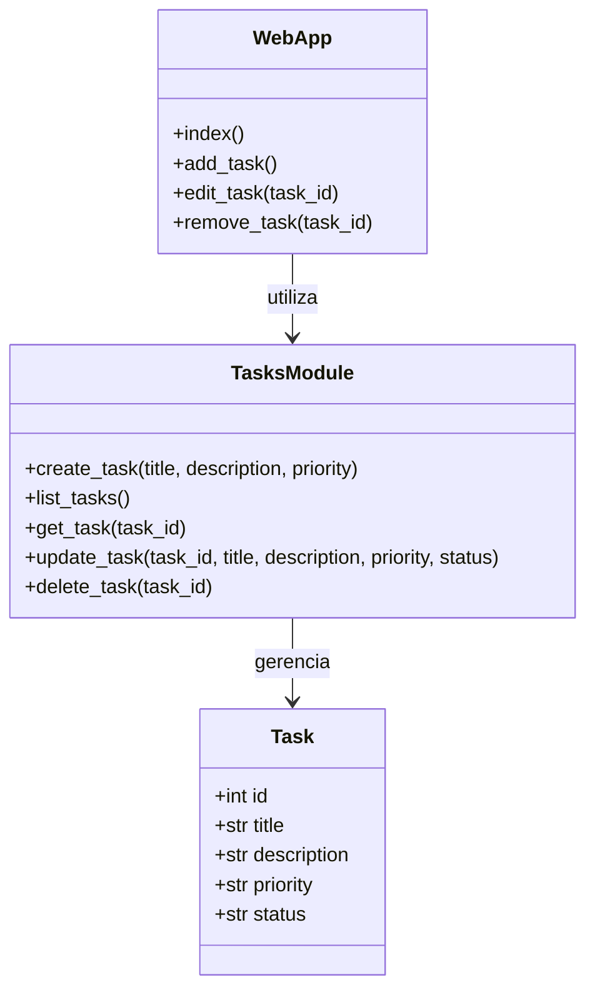
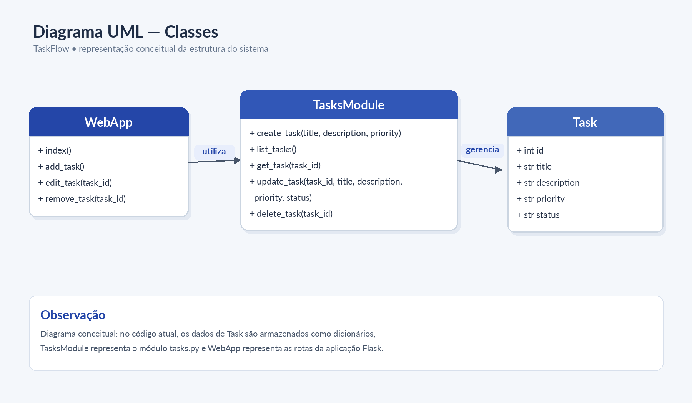

# Diagrama UML — Classes

**Observação:** o diagrama representa conceitualmente a estrutura e as responsabilidades do sistema. `Task` representa os dados de uma tarefa, armazenados como dicionário no código Python. `TasksModule` representa o módulo `tasks.py`, responsável pelas operações de gerenciamento, e `WebApp` representa as rotas e funções da aplicação Flask.
